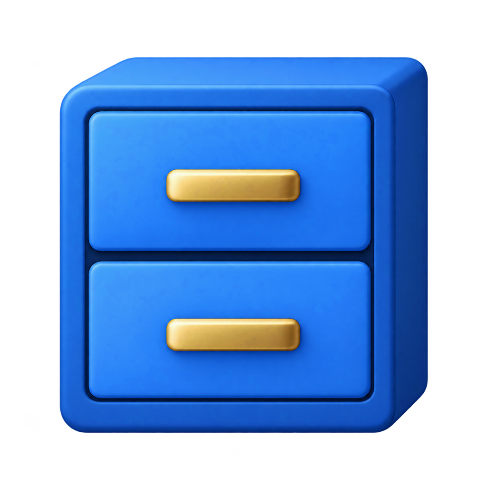

<p align="center"></p>

<h1 align="center">Cabinet</h1>

<p align="center">Keeps your Steam achievements, stats and playtime filed under the right game, even when an OnlineFix patch makes the game run as Spacewar.</p>

## Install

Open PowerShell and run:

```powershell
irm https://raw.githubusercontent.com/MRoiban/cabinet/main/install.ps1 | iex
```

Or download `Cabinet.exe` from the [latest release](https://github.com/MRoiban/cabinet/releases/latest) and double-click it.

That's it. Cabinet installs itself to `%LOCALAPPDATA%\Cabinet`, starts with Windows, lives in the tray (behind the `^` arrow), and updates itself from this repo's releases.

## What it does

Games patched with OnlineFix talk to Steam as AppID 480 (Spacewar), so Steam credits your hours and achievements to Spacewar instead of the real game. Cabinet fixes that:

- **Live playtime**: while the game runs, a hidden helper connects to Steam as the real game, so Steam counts the hours itself and shows them right away.
- **Achievements and stats**: copied from OnlineFix's local files (`C:\Users\Public\Documents\OnlineFix\<appid>\Stats`) into the real game's entry in the Steam client.
- **Missing achievement lists**: if Steam has never downloaded a game's achievement list, Cabinet fetches it automatically.
- **Friends' real games**: Cabinet Cloud shares the real OnlineFix game with other connected Cabinet users. Your Steam friends list can show its name while retaining Spacewar's Join Game.
- **Overview**: right-click the tray icon → *Games* for achievements unlocked, hours played and last sync per game.
- **English and French**: follows the Windows display language (set `CABINET_LANG=fr` or `en` to override).
- **Fallback**: if live tracking can't start, playtime is recorded and added to Steam the next time Steam is closed.

Achievements live in your local Steam client. Steam only uploads them to your public profile for games your account owns.

## Tray menu

| Item | |
|---|---|
| Games | Per-game achievements, hours, last sync. Click to open in Steam. |
| Sync now | Force a full sync. |
| Check for updates | Install the latest release now. |
| Open log | `%LOCALAPPDATA%\Cabinet\log.txt` |
| Cabinet Cloud | Connect, sync, disconnect, and enable real-game friend labels. |
| Uninstall | Remove from startup. |

Before Cabinet first changes a Steam file, it keeps a copy in `%LOCALAPPDATA%\Cabinet\backup`.

## Build from source

Needs only Windows (uses the .NET Framework compiler that ships with it):

```cmd
build.cmd
```

This produces `Cabinet.exe` (tray app) and `Cabinet-cli.exe` (debug commands: `--version`, `--sync <appid>`, `--dump <file>`, `--running`). Every push to `main` is built by GitHub Actions and published as a new release.

## Friends' real games

Connect each Cabinet client to the same Cabinet Cloud server. Cabinet shares the
running OnlineFix game's name and Steam account ID about once a minute; all
connected users on that server can read these reports. Reports expire after three
minutes. Only friends currently playing Spacewar (app 480) are relabeled in your
local Steam UI; their app ID and joining information remain intact.

Under **Cabinet Cloud**, choose **Show friends' real games (applies after Steam
restarts)**, then restart Steam yourself. This creates
`.cef-enable-remote-debugging` in Steam's folder and opens a **localhost-only
Steam UI debugging port (8080)**. Cabinet uses that port inside its tray process.
If the folder is not writable, the menu explains which file to create manually.
Disconnecting clears Cabinet's labels; lost connections and crashes are covered
by expiration. The Spacewar icon remains unchanged. Remove the marker and restart
Steam to turn off the debugging port.

Presence and relabeling run only while Cabinet Cloud is connected. If several
OnlineFix games run at once, Cabinet reports the first app ID in ordinal order.
Steam UI internals can change with Steam updates; unavailable debugging or cloud
requests are silently skipped, with one log entry per failure category.

Checks: `tests\run-controller-checks.cmd` and
`tests\run-friend-label-checks.cmd` (the latter also needs Bun for script checks).
The optional `--live` friend-label check installs and removes the hook, tests a
currently-playing Spacewar friend if available, and verifies restoration.
